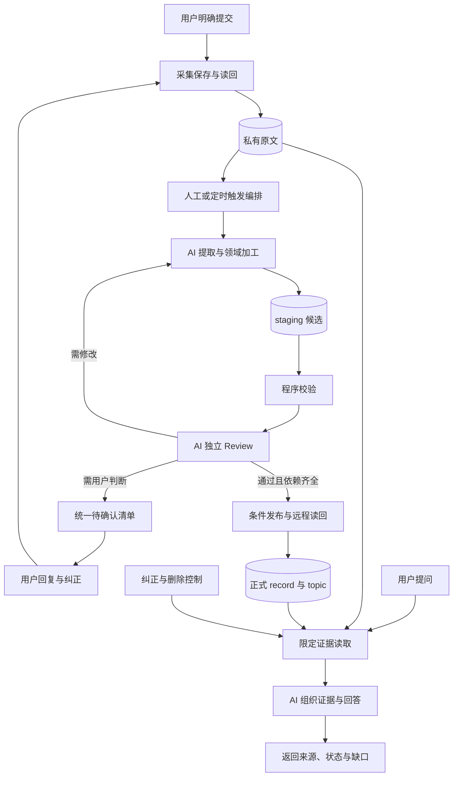

# 个人数字化记忆项目总方案

[技术方案](technical-plan.md) · [实现明细](implementation-details.md) · [Roadmap](roadmap.md)

## 当前建设状态与文档范围

既有工程已实现人工触发后的保存、分类提取、程序校验、独立Review、条件发布和限定读取；单独capture只保存原文。本批开发版为`0.2.0.dev27`，新默认Skill11/9，补调用等待时间与纯统计绑定缺失的定点返工；本批能力已实现，隔离定向回归和标准CLI人工全链通过，准确dev CI与新一轮获准真实验收仍待核，详见[Roadmap](roadmap.md)。本批仅dev开发验证，不合入或推送master，不自动重加工已有知识。

第一版知识维护目标与 M1 整体验收仍未完成：目标 GPT 云端每日北京时间 22:00 的任务尚未创建或启用，目标执行环境能力、两轮真实触发、云端持久状态恢复及第二模型独立读取仍待验证。人工加工和工程测试分别证明其实际范围，不能替代上述门槛；也不能用一个领域的资料补造其他领域的用户事实。

公开仓库是通用项目方案、产品设计、技术文档、工程代码、提示词、版本化 Skill、人工测试、CI 和工作流定义的唯一来源；个人原文、候选、正式知识、审核依据、控制、运行数据、私人验证及完整历史保留在独立私库。实际运行直接加载公库工程，数据读写明确指向私库，不再维护第二份工程。双仓入口只读核对准确公开 CI、同名分支及代码／资料边界，见[双仓使用说明](dual-repository.md)。定时编排、知识加工和复用／恢复代码统一在公库维护；目标 GPT runner 及真实定时触发仍待验证。每个工程提交的检查状态须单独核验，本次变更不预先声明新提交已通过 CI。

## 项目要解决什么问题

有价值的信息经常散落在不同地方：和模型讨论过的方案、临时记下的想法、收藏的文章视频，以及生活与工作中的变化。再次需要时，我们可能只记得聊过，却找不到原话；也可能找到旧结论，却不知道它是否仍然适用。目标、计划和实际结果分散保存，也让后续分析与复盘缺少连续的依据。

个人数字化记忆希望把用户明确提交的这些内容，整理成能找回依据、持续更新、方便迁移的长期记忆，再用于**健康&运动、工作事业、学习&能力提升**三个领域的分析与决策支持。领域键为 `health`、`career`、`learning`；目录映射与共享记录规则见[数据规范](data-conventions.md#知识领域与分类入口)。实际个人知识入口保留在独立私有资料库，不随工程文档公开。

完整使用过程是：**资料沉淀 → 了解个人现状与比较选择 → 用户选定目标和计划 → 用户实际执行并反馈 → 复盘与调整。** 系统整理证据、分析选项和辅助规划；用户负责决定与实际行动。知识库是这条路径的基础，也是当前第一版的建设范围。

知识库同时保留原始资料和整理后的知识。原文用于核对和重新理解，独立记录保存值得长期维护的信息，主题知识页将相关内容连接起来。采用 Markdown 文本和主题知识页（LLM Wiki），使长期记忆能够脱离某一次聊天、某一家模型服务继续保存和使用。

下文区分完整项目目标与第一版的预期体验。阶段进度和实际运行证据统一见 [Roadmap](roadmap.md)，能力是否可用以对应场景的运行结果为准。

## 第一版可以怎样帮助用户

以下均为假设场景，用于说明预期使用方式，不代表用户的实际经历、状态或决定。

| 场景 | 用户怎样使用 | 预期得到什么 |
| --- | --- | --- |
| 收藏资料后再次找回 | 提交一篇学习方法文章、一个视频或一份附件的链接，后来问“上次收藏的方法适合什么情况？” | 找到原链接及实际取得的内容；能读取正文时再整理要点。正文未取得就明确说明，不凭标题生成内容 |
| 延续跨平台的讨论 | 提交在其他模型应用中讨论职业发展的对话片段，后来问“当时有哪些选择？” | 找回讨论过程、各方建议和依据，区分用户自己的表达与模型提出的建议 |
| 记住想法与最终决定 | 先说“可以试试每天读论文”，后来明确决定“每周读两篇，目前还没开始” | 能说明最后的决定及其来源，同时保留“尚未开始”，不会把讨论中的想法当承诺 |
| 解释状态变化与纠正 | 补充“上个月的运动次数记错了，这个月又换了安排” | 分别回答过去和现在的情况，说明哪些是纠错、哪些是真实变化，旧错误不再作为有效依据 |
| 使用今天的新信息 | 上午提交新的学习目标，整理任务运行前就询问“现在的目标是什么？” | 可以参考当天原文，并说明尚未加工或审核；正式知识仍按既定流程更新 |
| 连接不同生活领域 | 提交“调整工作安排，为运动和英语练习留时间”的想法 | 同一份资料可以关联事业、健康和学习，保留共同来源；不强行把所有内容归入三个领域 |
| 集中补充不明确的内容 | 资料中提到“下个月开始”，但没有确定日期 | 日期保持未知；确实需要澄清的问题汇总到待确认清单，用户集中处理，其他内容继续整理 |

健康、事业和学习共享同一份知识基础。用户不需要先决定资料属于哪个角色，也不必为了涉及多个方向而重复提交。是否形成长期计划、是否采纳建议、是否实际执行，始终以对应的用户表达或记录为依据。

## 知识库之后，怎样帮助分析与行动

| 后续场景 | 用户怎样使用 | 预期得到什么 |
| --- | --- | --- |
| 结合个人情况分析问题 | 提出一个真实的健康、职业或学习问题，允许读取相关记录 | 结合当前情况、历史和现实约束比较选择，说明证据与资料缺口 |
| 把选定目标变成计划 | 用户选定一个目标，提供真实可投入的时间与资源 | 可比较的执行路径，以及用户确认后的行动顺序和完成标准 |
| 根据实际结果复盘 | 用户补充完成情况、未完成事项及原因 | 对照计划与实际结果，提出继续、调整或停止的选项，用户决定下一步 |

这些是后续建设目标，具体顺序和场景见 [Roadmap](roadmap.md)。三个方向共享同一份个人记忆，后续能力继续复用原始证据、审核和更新机制。

## 第一版怎样使用

交互入口先采用 ChatGPT 的多端使用方式，尽量让提交、查阅和补充都在熟悉的对话中完成。具体提交方式与反馈形式会通过少量资料试跑确定。

1. **明确提交。** 告诉系统希望保存哪些文本、对话片段、想法或链接。普通讨论与正式提交需要区分，不能默认把所有聊天都收进知识库。
2. **确认保存结果。** 原始资料先保存成功，再反馈保存结果；只有链接、正文未获取、保存失败等情况需要如实说明。原文已保存与知识已整理是两种不同状态。
3. **人工触发自动整理。** 用户明确启动获准收集／加工后，编排自动处理新增、变更及未完成资料，提取分类、关联旧知识、独立审核后发布。M1 每日一次云端整理目标单独接入验收。
4. **随时提问。** 用户可以问某个结论的来源、当前和过去的状态，或相关主题有哪些资料。回答结合已有知识与必要原文，说明依据、时间及不确定之处。
5. **集中确认与纠正。** 需要人判断的事项放进统一清单。用户的回复、纠正和补充作为新证据进入后续整理，相关知识随之更新。

不需要用户逐条审核所有整理结果。常规内容由模型审核；涉及含义不清、相互冲突或必须由用户决定的问题，再交给用户确认。等待回复不会占住整个加工队列，也不会阻止无关的通过项发布。

## 信息如何流动

整体按四层协作。下图展开第一版知识库从采集、加工到审核发布和按需使用的信息流。后续分析、计划和复盘继续复用这些层次。

| 层 | 用户可以怎样理解 |
| --- | --- |
| 第一层：人机交互 | 提交资料、提出问题、查看结果，提供确认和纠正 |
| 第二层：个人知识与决策 | 理解资料、提取与整理知识、审核内容，以及根据证据组织回答；第一版先聚焦知识库 |
| 第三层：公共工程能力 | 安排流程、调用所需能力、控制实际读写，记录结果并处理失败 |
| 第四层：数据与存储 | 持续保存原文、候选内容、正式知识、待确认事项及版本历史 |

**知识加工任务编排横跨第二、第三、第四层。** 它覆盖读取待处理资料、提取与领域加工、保存候选、校验与模型审核、返工或登记待确认事项、发布通过项，以及记录本轮结果。一次任务跨层执行，各环节仍按上表承担职责。

图中 **AI** 标识三个需要模型参与的环节：**提取与领域加工、模型 Review、组织证据与回答**。前两个由人工启动后的自动编排组织，第三个由用户提问按需触发。采集保存和即时问答可独立于批次加工运行，用户不需要等到下一次整理才能查阅已保存的原文。

一份资料通常先成为可回溯的原文，再产生待审核的候选内容，通过后进入正式记录和主题页。需修改的内容回到加工环节；需用户判断的内容进入清单。用户反馈回到采集入口，形成下一轮更新依据。

图中的原始资料也有通往回答的路径，表示尚未加工的信息可以参与使用。但回答必须说明其状态，并检查是否存在纠正、撤回或删除；引用一次原文不会让它自动变成已审核知识。

## 如何保证资料可信、可维护

**结论能够回到来源。** 用户可以查到某项知识来自哪份资料或哪段发言。系统需要区分用户自述、外部观点和模型推断；收藏一篇文章不等于认同其中全部观点，模型提出建议也不等于用户已经决定或执行。

**审核与事实核验分开。** 模型 Review 检查整理是否忠实、依据是否充分、时间和状态是否表达正确。审核通过表示达到知识发布要求，不代表所有内容都已得到独立事实核验。资料不足、证据有分歧或没有获得全文时，应明确指出缺口。

**变化和错误分别处理。** 真实变化保留过去在当时成立的情况；错误纠正则指出旧内容有误，并更新受影响的知识。原文未提供的时间保持未知，不能用保存时间替代事情发生时间。无法可靠判断的冲突进入待确认清单。

**生成内容保留依据。** 总结、回答和建议来源于已有资料，不能再被当作新的独立证据反复证明自己。知识页发生更新时，需要维持与原始依据的联系。

**保存成功有实际结果。** 只有资料真正写入并能够读回，才能报告已保存或已发布。每日任务未完成时，应保留已完成、待确认和失败的范围，后续继续处理，避免重复保存同一份内容。

## 数据保存与使用边界

长期文本知识和链接记录放在私有 Git 仓库中，保留本地副本，利用版本历史支持回溯和恢复。普通删除只从当前版本移除，历史记录仍可能保留；如果需要连历史一起清除，须另行明确范围。被删除内容也不应在下一次加工时被无意恢复。

附件目前只保存链接与必要说明，**并不备份附件本体**。原文件的权限、有效性和可访问性仍由原存放位置决定；取得的正文或转录可以作为相关文本保存，但不能据此声称原文件已经备份。

第一版以用户明确提交的资料为范围。ChatGPT 是交互入口，不代表已经自动取得 ChatGPT、Kimi、豆包等平台的全部历史；其他平台的历史导入和持续采集尚未打通。Git 存储与云端模型处理也属于不同边界，实际接入时需要确定读取范围、模型和工具权限，不默认将全库交给任意模型。

采用开放文本格式，目的是让资料可以长期保存和迁移，并支持未来更换模型。第一版先通过文件、链接与文本查找使用知识，不建设专门索引，后续再根据内容规模增加检索能力。

## 第一版范围与下一步

第一版目标是完成“明确提交—原文保存—每日整理—审核发布—按需查阅—确认纠正”的知识维护闭环。应能保存少量真实资料，形成可追溯的正式记录与主题页，提供统一待确认清单，并通过真实问题证明这些内容能被正确使用。

独立 App 或小程序、全量跨平台自动采集、三个独立运行的 Agent、附件原件备份、专门检索索引，以及持续的个人分析与计划、行动反馈和复盘，暂不纳入第一版。计划由用户决定，实际行动由用户执行和反馈。已经提交的目标、决定和实际经历仍会准确记录，后续能力在此基础上扩展。

建设从少量真实资料开始，先验证保存、加工、审核、发布和问答，再扩展日常维护与每日运行。当前起点、待落实事项和阶段进度统一见 [Roadmap](roadmap.md)。

判断第一版是否可用，重点看用户能否找回依据、分清当前与历史、使用当天新资料，以及在信息不够时得到明确说明。完成文档或生成一份摘要，都不能替代这些实际验证。

## 继续了解

本页介绍项目价值、使用方式、整体逻辑与范围。希望理解系统组成、运行位置和设计原因，可以继续阅读[技术方案](technical-plan.md)；需要建设或维护系统，可以进入[实现明细](implementation-details.md)，并查阅[数据规范](data-conventions.md)与[场景验收](scenarios-and-acceptance.md)。

各文档区分当前已实现的工程能力、已确认的项目目标与待验证的外部接入。真实资料及其验收历史保留在私有资料库；公开工程测试不能替代真实使用验证。
