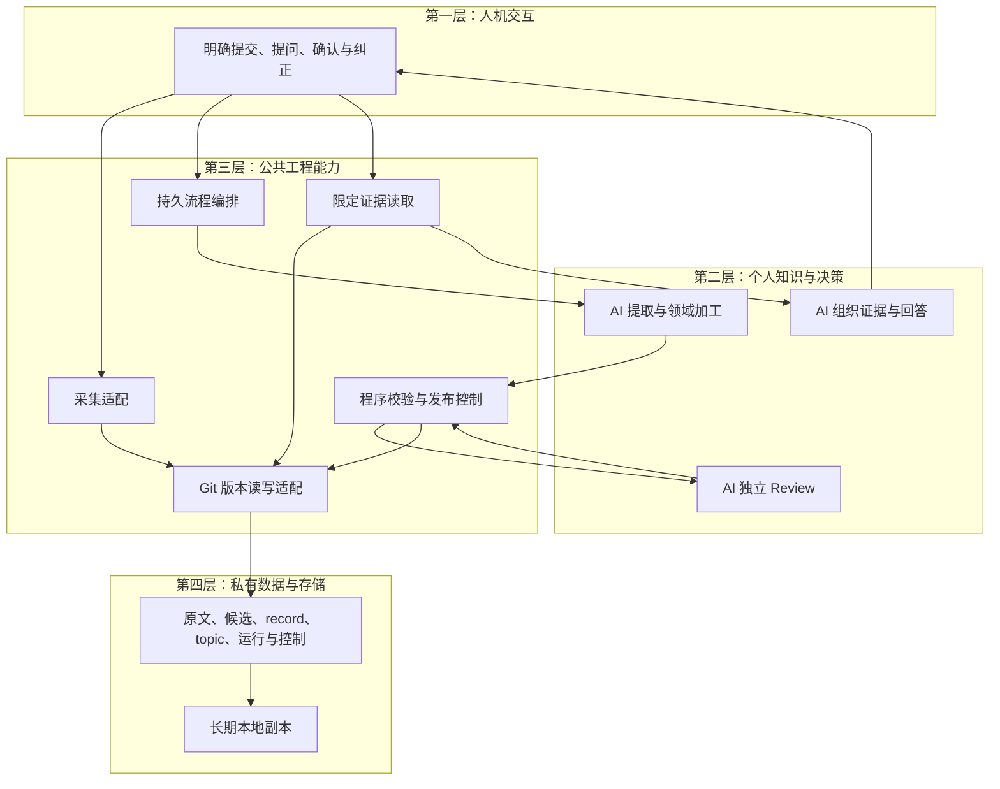

# 个人数字化记忆 · 技术方案

[总体方案](overall-plan.md) · [实现明细](implementation-details.md) · [Roadmap](roadmap.md)

本文说明系统组成、运行位置、模块交接和设计取舍。当前程序为 `0.2.0.dev19`；字段与状态统一在[数据规范](data-conventions.md)，执行过程统一在[实现明细](implementation-details.md)，检查方法统一在[场景与验收](scenarios-and-acceptance.md)。工程交付与恢复遵循[发布与回滚](release-and-rollback.md)。

## 当前实现与双仓边界

现行路径为 **明确提交 → 私有原文 → staging 候选 → 程序校验 → 独立 Review → 条件发布 record／topic → 限定证据读取与问答**。自动三领域归类在原提取和独立审核中完成，领域键为 `health`、`career`、`learning`，不增加一个分类模型阶段。人工触发后由现有受控环境推进 `production`；原生 `capture` 仍只负责保存。

公开工程仓库保存通用方案、产品设计、技术文档、代码、版本化 Skill、人工测试及 CI，个人原文、正式知识、审核、数据运行绑定和全部个人历史保留在独立私库。当前实际程序仍从私库工程副本加载；只读 `check_dual_repo.py` 核对两库边界、指定公库提交的准确 CI，以及 71 个核心文件的完整路径集合、Git 模式和内容。它不自动复制或迁移文件，不运行资料加工，也不合并两库历史。公库工程提交与私库程序提交分别记录，公库 CI 不替代不同私库提交或真实业务验收，操作见[双仓使用说明](dual-repository.md)。本次文档整理不声明新提交已通过 CI。

`production` 已接入持久队列、分批／最终合并、分解审核、有限重试、未知对账、统一待确认续接、条件发布与远程读回门禁；限定当前读取支持选择正式 record 或 topic，自动核齐主题的精确 record 依赖，并可去除重复原文 `body`。旧正式知识和规则不因默认值升级而自动重跑。

M1 整体尚未验收。目标 GPT 云端任务拟按 `Asia/Shanghai` 每日 22:00 运行，当前尚未创建／启用；目标 runner 的真实能力、两轮实际触发、云端持久状态恢复及获准第二模型读取仍待验证。手动链路、人工测试与公开 CI 各自保留证明边界，不代替这些条件。

## M1 知识质量与 Skill 接入

新任务默认固定 `knowledge-extract@8` 与 `knowledge-review@6`。模型接入层实际加载对应 `SKILL.md`、共享质量规范、知识语境规范及输出契约，保存完整快照并绑定请求、候选和审核结果。Skill 规定怎样组织和复查知识，程序检查可确定的结构与绑定；加载成功本身不能证明输出合格。

现行质量路径为：固定来源及 Skill 引用 → 程序准备资料清单与可复算统计 → 模型按加工 Skill 提取分类和组织知识 → 程序校验覆盖、数字、引用、时间和版本 → 独立模型按审核 Skill 逐项复查 → 完整证明与条件发布。Skill、必要依赖或检查失败时保留原因，不退回普通提示词绕过发布门禁。

| 层次 | 质量路径的职责 |
| --- | --- |
| 第二层 | 两个角色 Skill 共用质量规范；组织期间概览、指标去向、时间和范围自足，核对有依据的关联与解释边界 |
| 第三层 | 受控解析 Skill；执行确定性清单、统计和校验；固定真实请求与版本，保持分批、有限重试、未知对账及发布控制 |
| 第四层 | 保存可恢复 Skill 及依赖绑定、资料清单、计算依据、覆盖说明和逐项审核证据；原文仍是事实根依据 |

M1 可形成描述性期间知识：在含义、单位和可比条件明确时计算分段统计，标注算法、区间、有效样本、缺失与未完结日处理；派生值不得冒充原始报表字段。M2 才进一步结合个人问题解释原因和比较建议。来源中的旧状态只用于其当时语境，当前系统状态须另有固定版本或回执证明。

新质量运行使用 schema `0.10`；原文／采集 `0.1`、正式知识 `0.2` 与 group wrapper `0.6` 保持。基础提示词仍为 extract v14／review v10／answer v7，新增质量规则由明确版本的 Skill 提供。历史请求及 Skill 精确保留，不回填“已加载 Skill”。传输使用完整可逆共享值、字段字典与列式编码；全部原文、规则、候选、真实意见和计算范围都计入实际请求字节，完整必要单元超限时停止。

详细规则见[第二层](technical-plan/02-knowledge.md#m1-skill-quality)，字段、执行与验收分别见[数据规范](data-conventions.md#skill-quality-contract)、[实现明细](implementation-details.md#skill-quality-execution)与[场景验收](scenarios-and-acceptance.md#skill-quality-acceptance)。阶段退出条件见 [Roadmap](roadmap.md#m1-skill-quality)。

## 1. 方案概览

项目将用户明确提交的对话、想法和资料，沉淀为可追溯、可维护、可跨模型使用的个人知识，再逐步支持健康、事业、学习方面的分析、计划与复盘。

**当前批方案：ChatGPT多端明确提交／人工触发＋现有受控环境自动编排＋模型加工与独立审核＋程序控制发布＋私有Git／Markdown存储。** 第一版复用现有执行环境与连接工具，先用一条小规模处理链路验证价值和可靠性。两个加工角色通过显式引用版本化 Skill 执行知识质量规范；完整项目验收状态见 [Roadmap](roadmap.md)。

| 第一版交付 | 已确认边界 |
| --- | --- |
| 原文采集、知识整理、来源问答、确认与纠错 | 只处理明确提交的材料，不默认获取各平台全部聊天历史 |
| 人工触发自动整理 | 收集后由现有受控执行环境推进production，不依赖Cloud Tasks；原M1北京时间22:00云端目标及两轮触发另验 |
| 原文先保存，Review 后发布正式知识 | 未加工原文可参与回答，但须说明状态；需用户判断的事项汇总呈现 |
| Markdown／LLM Wiki、私有 Git 与本地副本 | 附件先存链接，第一版不建专门索引、不要求三个独立 Agent 服务 |

后续分析、目标计划和复盘复用同一份证据与版本体系。用户负责选择和实际行动；模型建议不自动成为用户决定，未反馈的行动保持未知。

## 2. 技术架构

采用与总体方案一致的四层划分，每层内部按职责拆分模块。**层表示职责归属，知识加工编排跨越模型、工程及存储三层。**

| 架构层 | 图中模块与数据区 |
| --- | --- |
| **第一层：人机交互** | ChatGPT 多端入口：多端采集、问答与确认 |
| **第二层：个人知识与决策** | 提取与领域加工、独立 Review、组织证据与回答；第一版先聚焦知识库 |
| **第三层：公共工程能力** | 采集适配、流程编排、程序校验、发布控制、证据读取、Git 读写适配器 |
| **第四层：数据与存储** | 私有 Git／Markdown 中的原始资料、候选变更、正式记录＋Wiki、运行与控制记录，以及长期本地副本 |

逻辑分层不等于独立部署。第一层提供用户入口；第三层在受控执行环境中调度第二层模型能力，并经 Git 读写适配器访问第四层文件。图中 **AI** 标出三个模型环节。图中箭头表示关键交接，实际模型调用和结果保存由流程编排推进。

- **采集：** 多端采集 → 采集适配 → Git 读写适配器 → 原始资料与保存回执。保存成功不等于知识已经发布。
- **加工：** 流程编排按每日或手动触发，选择增量并固定版本 → 提取与领域加工 → 程序校验 → 独立 Review → 发布控制 → Git 读写适配器 → 正式记录＋Wiki。候选、审核和进度持续保存；返工和待确认不阻塞无关通过项。
- **消费：** 问答与确认接收问题 → 证据读取经适配器取得正式知识、相关未加工原文和控制记录 → 组织证据与回答 → 返回用户。确认、纠正与补充重新进入采集链路。

知识加工编排横跨第二至第四层，当前人工启动后覆盖加工及相关持久化；采集与即时问答按需独立运行。原M1每日入口另接。完整业务信息流见[总体方案泳道图](overall-plan.md#信息如何流动)。

## 3. 核心模块与职责边界

本页保留评审概览，各层执行细节见下列子文档；通用字段和验收仍引用统一规范。

以下模块名称与架构图对应；交互入口与数据区归属见上表。Skill 和质量检查属于现行实现；图片展示主要职责，完整版本绑定、分解审核与恢复细节以本文及实现明细为准。

| 所属层 | 模块 | 核心职责与边界 |
| --- | --- | --- |
| 第二层 | 提取与领域加工 | 在提取调用中自动判断三领域归属，产出有证据的候选及 Wiki；引用加工 Skill 组织期间概览、指标去向与时间限定，同一事实跨领域共享 |
| 第二层 | 独立 Review | 对照原文、候选、相关旧记录及领域策略；引用审核 Skill 检查覆盖、统计和时间，输出逐项依据与绑定版本的意见；审核通过不等于独立事实核验 |
| 第二层 | 组织证据与回答 | 根据证据生成带来源、时间、状态和缺口的答案；回答不直接写入正式知识 |
| 第三层 | 采集适配 | 保存实际取得的内容、来源版本与回执；缺正文只记链接和获取状态，不凭标题生成原文 |
| 第三层 | 流程编排 | 选择增量、固定版本、调用各阶段并保存续跑进度；解析与装载指定 Skill、固定依赖及请求摘要，纳入新增、修改、历史补录和未完成项 |
| 第三层 | 程序校验 | 检查结构、引用、版本；准备资料清单、可复算统计及覆盖／时间依据绑定，通过后才送独立 Review，语义仍由模型核对 |
| 第三层 | 发布控制 | 核对审核、内容、路径和基础版本，形成获准发布的变更包；模型角色不能自行绕过 |
| 第三层 | 证据读取 | 查找正式记录与来源，同时检查相关新原文、纠正和删除，向回答模块提供证据集合 |
| 第三层 | Git 读写适配器 | 统一按版本读取、条件写入与提交后读回；正式写入只接受发布控制批准的变更包 |

模块间交接有版本的文件与变更包。第四层将原文、候选、正式知识及运行控制分开保存，避免混淆加工状态与知识状态。接口字段、对象结构和调用步骤分别在[数据规范](data-conventions.md)与[实现明细](implementation-details.md)维护，本页不重复展开。

### 3.1 第一层：人机交互

[查看可缩放图](diagrams/layer-1-interaction.svg) · [第一层详细技术文档](technical-plan/01-interaction.md)

**多端采集**接收明确提交的资料，经第三层采集适配保存并读回后返回回执；**问答与确认**将问题交给第三层证据读取，再展示第二层生成的答案。确认、纠正和补充作为新证据回到采集路径；入口分别呈现“原文已保存”和“知识已发布”，不混用两种结果。

### 3.2 第二层：个人知识与决策

[查看可缩放图](diagrams/layer-2-knowledge.svg) · [第二层详细技术文档](technical-plan/02-knowledge.md)

**提取与领域加工**读取所选原文和相关旧记录，在同一次提取中完成公共提取及三领域判断，合并候选记录与 Wiki 变更，共享事实只保留一份。第三层检查领域键、结构和引用后，调用**独立 Review**同时审核内容与分类依据并绑定版本。发布后的三领域目录由第三层从受控当前证据派生，保留未知分类和读取缺口。**组织证据与回答**另行接收第三层提供的证据集合，生成带来源和缺口的答案；这些模型环节均不直接发布正式知识。此项属于M1的加工与读取闭环，不需额外分类模型调用，也不等于云端定时触发已接通。

新增的[Skill 质量路径](technical-plan/02-knowledge.md#m1-skill-quality)把规则引用作为模型接入契约：两个角色分别加载固定 Skill，共用质量标准，并把实际提供的规则、资料覆盖、计算依据和逐项审核绑定最终候选。来源类型规则适配表格、对话与文章；普通 Skill 名称或模型“已执行”声明不能充当装载／验收证据。

资料增多时，现有[分批、跨批合并及重试机制](technical-plan/02-knowledge.md#分批加工与跨批合并设计)保留完整语义与来源位置。多批草稿不能独立发布，最终变更合并提取并取得独立审核与完整依赖证明后一致提交；完整审核请求按实际容量选择单次或 object／coverage／global 分解策略。单个持久尝试身份首次失败后最多重试 3 次，结果未知先对账。日常 `audit` 模式不设每日或历史累计模型调用总次数上限；容量、并发、速率、服务条件和明确的资料／服务权限仍约束处理，调用逐次留痕。旧有限预算模式按原契约保留，不自动转换。

默认 production 的多批草稿路线仍须最终合并提取和独立审核；`draft_only`不能发布。另有显式 final-runs 组发布接口：不新增正文或关系时，可在同一完整计划、来源／版本／控制、对象冲突及精确依赖检查通过后原子提交原样受审对象。它不新增模型合成或跨运行语义审核，也不是 production 自动选择的优化。需要新的综合或关系时，仍须形成新候选并独立审核。

### 3.3 第三层：公共工程能力

[查看可缩放图](diagrams/layer-3-engineering.svg) · [第三层详细技术文档](technical-plan/03-engineering.md)

**流程编排**固定输入版本，依次调用加工、执行**程序校验**、调用独立 Review，再交给**发布控制**核对审核、内容、路径和基础版本，通过**Git 读写适配器**写入并读回。失败、返工与待确认项保存状态，后续按条件续跑，无关通过项继续发布。按需触发的**采集适配**与**证据读取**共用同一适配器，统一文件访问和版本检查。

### 3.4 第四层：数据与存储

[查看可缩放图](diagrams/layer-4-storage.svg) · [第四层详细技术文档](technical-plan/04-storage.md)

**原始资料**保留实际取得的内容，**候选变更**保存待审核结果，**正式记录＋Wiki**分别承载独立知识与主题综合，**运行与控制记录**保存进度、审核、回执及待确认和删除控制。稳定 ID 关联对象，来源版本与片段位置定位证据；相互依赖的正式变更一致提交到私有 Git，读回后确认结果。**长期本地副本**用于同步、读取与恢复。

## 4. 关键技术决策

| 选择 | 采用原因 | 代价与演进条件 |
| --- | --- | --- |
| **文件为长期载体，Git 管理版本** | 人和模型均可读取，便于追溯与迁移；原文、独立记录、Wiki 分工明确 | 需要维护引用和并发一致性；未来索引从文件重建，不另建事实副本 |
| **单流程编排，按需调用领域角色** | 初期维护成本低，三个领域共用事实与处理规则 | 吞吐量有限；出现任务互相干扰或明显积压时再拆分执行能力 |
| **模型加工与工程发布分工** | 模型负责理解，程序约束实际写入；独立 Review 对照原始证据 | 增加审核与校验成本；必须验证发布约束真实生效 |
| **第一版不建专门索引** | 先用少量真实资料跑通，减少前置建设 | 文件增长可能影响速度或遗漏证据；用验收问题和实测耗时决定何时增加索引 |
| **复用云端执行环境与连接工具** | 支持每日运行，减少初期服务维护 | 可用能力取决于实际任务环境；关键步骤受限时调整对应适配方式 |

Markdown／Git、无专门索引等范围要求已确认。现有程序已经实现单流程编排、调用绑定与发布门禁，真实环境的权限和强制控制仍按场景实测。私有远程 Git 用作个人文本的同步与恢复依据；临时目录不能承担唯一存储职责。

## 5. 可靠性与数据边界

**证据可回溯。** 来源保留原文版本和片段位置，回执能定位实际 Git 快照。原文、独立记录与主题综合分别维护；模型摘要和回答不能作为新的独立证据反复支持自身。

**正式发布受控。** 模型仅产生候选与审核意见，发布程序拒绝缺失审核、版本不匹配和越界路径。相互依赖的正式记录与 Wiki 一致提交；写入采用基础版本检查和冲突拒绝，相关依据变化后重新审核。只有远程写入并读回成功，才报告远程发布完成；本地提交成功单独标明。如果环境允许绕过入口直接写正式文件，就尚未形成强制发布控制。

**中断可续跑。** 输入、候选、审核及发布结果分别持久保存。写入结果不明先查询远程已有结果，已成功则补回执，避免重复发布。返工有上限，待确认事项登记后可以结束本轮。

**读取保持时效与范围。** 按主题、主体、时间和文本查找正式记录，再定位来源，同时检查相关未加工增量、纠正及删除控制。超出读取预算时明确缺口，不声称已确认最新情况。真实变化与错误纠正分开，未知时间不编造。

**访问按授权范围执行。** 私有 Git 存储不代表任意模型可读取全库；原文中的指令不能改变任务权限。凭证不入 Git，仅保存可见对话和必要工具结果。附件链接不构成本体备份；普通删除保留 Git 历史并防止误重建，彻底清除历史另行确定范围。

## 6. 实施重点与验证关口

当前首先需要证明：**上述设计在选定执行环境里可以完整运行。** 文档完善和 Git 文档提交成功，都不能替代这项验证。

| 验证关口 | 必须取得的证据 |
| --- | --- |
| **小样本端到端** | 一段真实资料完成保存、加工、独立 Review 和发布；新会话能答对问题并找到原话 |
| **发布与恢复控制** | 缺少或错配审核实际被拒绝；并发修改不被覆盖；提交后中断能恢复且不重复发布 |
| **每日运行与持续使用** | 实际定时环境完成两轮增量处理；新原文与纠正能影响回答；本地恢复及获准的另一模型读取通过验证 |

最大接入风险在于定时环境是否具备完整权限与工具能力。先验证读取、独立模型调用、程序校验、条件写 Git 和持久状态恢复；缺项就记录具体阻塞，调整接入方式，不能把手动成功标记为定时成功。

资源控制先从单份资料、串行处理开始。记录耗时、可取得的模型用量、失败与剩余范围，据此确定单批容量、并发、请求速率及有限重试策略；日常运行不设置每日模型调用总次数上限，当前不预设缺乏测量依据的性能或成本承诺。

阶段顺序与实际进度见 [Roadmap](roadmap.md)，详细检查方法见[场景与验收](scenarios-and-acceptance.md)。目标、计划和复盘的专用规则随对应阶段展开。

## 7. 参考依据

本方案借鉴以下项目的架构机制，未整体采用其框架。调研日期：2026 年 10 月 15 日。

| 一手资料 | 借鉴内容 |
| --- | --- |
| [Basic Memory 技术架构](https://docs.basicmemory.com/reference/technical-information)与[仓库架构](https://github.com/basicmachines-co/basic-memory/blob/main/docs/ARCHITECTURE.md) | 文件与派生索引分离、统一持久化入口；Review 门槛由本项目定义 |
| [GraphRAG 数据流](https://microsoft.github.io/graphrag/index/default_dataflow/)与[架构](https://microsoft.github.io/graphrag/index/architecture/) | 分阶段加工、来源关联与可替换适配器 |
| [LangGraph 持久化](https://docs.langchain.com/oss/python/langgraph/persistence) | 运行状态与长期知识分开、按持久边界恢复 |
| [Immich 架构](https://docs.immich.app/developer/architecture/) | 业务处理与外部技术适配分离 |
| [arc42 技术决策](https://docs.arc42.org/section-9/)与[质量要求](https://docs.arc42.org/section-10/) | 说明选择、代价，并用场景验证质量 |
