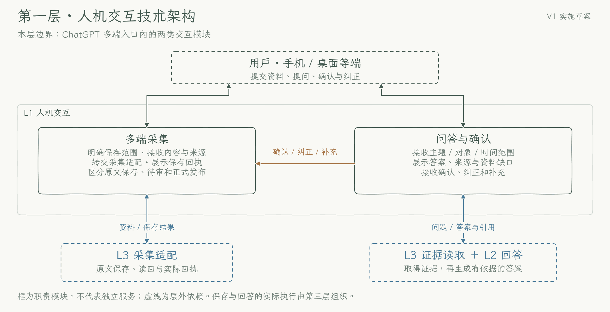

# 第一层：人机交互

[返回技术方案](../technical-plan.md#31-第一层人机交互) · [数据规范](../data-conventions.md) · [执行明细](../implementation-details.md)

本层复用 ChatGPT 多端入口，负责接收明确提交的资料、问题与反馈，展示保存和回答结果；实际采集、读取与写入交给第三层执行。当前工程支持人工触发后的受控加工与限定读取，多端接入、真实定时任务和 M1 整体验收仍以 [Roadmap](../roadmap.md) 为准。

## 本层技术架构

实框为本层模块，虚线框为层外依赖；箭头表示交接关系。图用于解释职责，图中实施草案说明与旧实现细节以本文和现行技术方案为准。

[实现原理图 PNG](../diagrams/layer-1-interaction.png) · [可缩放 SVG](../diagrams/layer-1-interaction.svg)

## 模块与交接

| 模块 | 接收什么 | 交给谁、返回什么 |
| --- | --- | --- |
| 多端采集 | 明确提交的文本、对话、想法或链接，以及必要来源上下文 | 交第三层采集适配；展示实际保存回执与获取状态 |
| 问答与确认 | 问题、来源追问、确认、纠正与补充 | 问题交第三层证据读取，再由第二层回答；反馈作为新证据回到多端采集 |

## 处理路径

1. **分清提交与提问。** 明确保存范围才进入采集；普通讨论不自动保存。一次消息同时包含资料和问题时分别处理，回答使用尚未加工的资料须说明状态。不清楚的保存范围先澄清。
2. **保存后给回执。** 采集适配取得实际内容、识别重复，经 Git 写入并读回后，入口展示来源位置、获取情况与后续整理状态。同一提交重复发送时返回已有结果；不得仅凭模型说“记住了”报告保存成功。
3. **提问即时处理。** 将主题、对象和时间范围交给证据读取，展示第二层生成的答案及来源、时间、状态和资料缺口。查询不等待每日加工，也不因回答一次就把内容正式入库。
4. **反馈形成新依据。** 确认或纠正关联原问题、待确认事项或来源，保留用户原话，走采集路径。收到答复不等于相关知识已经更新；需等后续审核发布结果。

## 异常与边界

正文不可获取时，展示“仅保存链接”或“取得部分内容”；保存失败则说明未保存，结果不明交第三层核对后再重试。答案证据不足时呈现缺口，不用旧会话记忆补成确定事实。入口区分原文保存、候选待审与正式发布。

只处理明确提交的可见内容，不默认取得其他平台全部历史；附件链接不代表本体备份。凭证不进入保存内容。模型建议、用户采纳与实际执行分别表达。真实资料的采集与问答在独立私有工作区执行，公开工程仓库只维护通用方案和人工测试。

验证复用[基础场景 S1—S8](../scenarios-and-acceptance.md#s1s8-基础场景)，重点检查重复提交、当天新资料与纠正反馈。实际接入时落实各端提交方式、执行工具权限和可打开的回执形式，结果记入 [Roadmap](../roadmap.md)。
