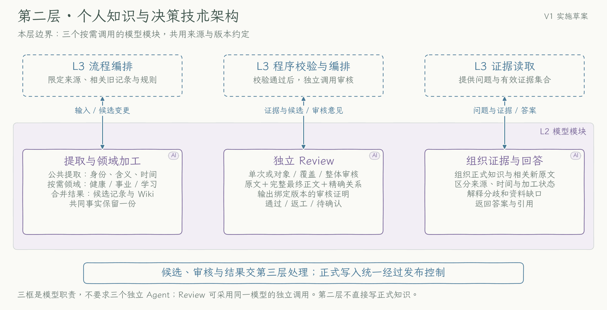
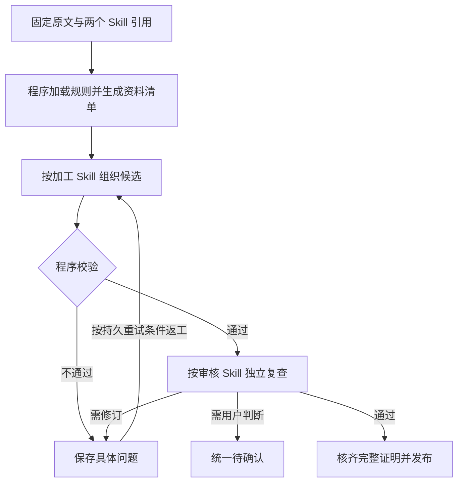
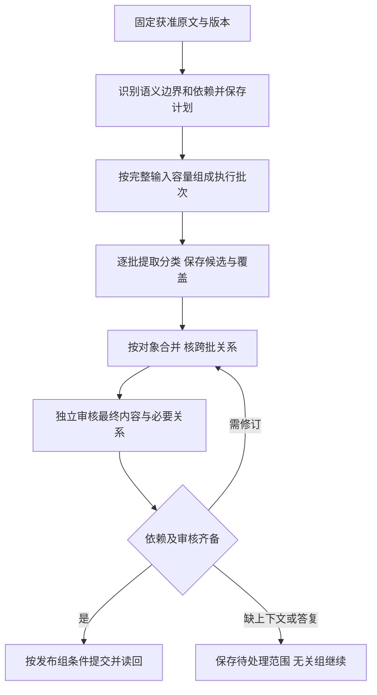

# 第二层：个人知识与决策

[返回技术方案](../technical-plan.md#32-第二层个人知识与决策) · [数据规范](../data-conventions.md) · [执行明细](../implementation-details.md)

## 当前范围

当前dev40统一现有受控提取失败的私有诊断，普通增量按旧Wiki顺序组装完整对象与精确refs，并补人工多来源的完整成功和返工后成功验收。模型继续负责正文语义、分类、事实变化与真实缺口；程序不自动拼回遗漏内容或放宽质量门禁。旧无顺序标记候选按旧行为核验，batch显式record_ids保持；Skill15/13、普通质量0.22、source-quality-v2及全部既有schema不变。仅dev，不新增阶段、索引或模型角色，不恢复旧丢失返回或重开耗尽工作；准确CI与真实业务分别核验，见[本批合同](../data-conventions.md#combined-incremental-contract)。

dev35保持原模型角色与Skill12/10。coverage按完整表格来源分别阅读，并携完整说明／字典；global依据全部已核覆盖证书、完整最终正文、全来源范围清单和关系图做汇总一致性核对，不把证书当作亲自读过原文。旧v1计划及请求按原字节恢复，不能原地套新布局。原已完成提取因审核容量阻塞时，只有第三层完成受限Git／audit核验才复用原结果；本层仍须独立审核，不新增提取角色或发布豁免。新plan／proof为0.19，普通候选0.18保持；工程和真实结果分别取证，见[合同](../data-conventions.md#review-material-recovery)。

本层负责理解、归类、审核和回答，第一版聚焦知识库。dev34批次使用新不可变`knowledge-extract@12`／`knowledge-review@10`，在同一提取／校验／独立Review／发布中补齐精确旧统计继承、程序校验失败反馈与最终内容完成度。三领域共用规则，时间依据要求保持，不增加模型角色。工程回归、准确CI与真实新增验证分别取证；真实发布与读取复验尚未完成，不更新master、不启动M2，状态见[Roadmap](../roadmap.md)。

人工触发后的受控分类加工、独立审核、完整 proof 发布及限定读取已有工程实现；current 已支持按正式 record／topic 路径选择，主题自动带上精确版本的 record 依赖，`compact_sources` 可去掉重复原文副本。程序先核对发布、来源、控制和版本，再把必要证据交给模型；选择齐全与是否读遍全部资料分别报告。读取不改变原文、正式知识或来源权限，命令见[日常使用](../daily-use.md#selected-knowledge-reading)。

来源／采集 schema `0.1`、正式知识 `0.2` 保持，新15/13普通质量链使用`0.22`，旧14/12为`0.21`、13/11为`0.20`、12/10为`0.18`、11/9为`0.15`、10/8为`0.12`、9/7为`0.11`、更早为`0.10`，已有assembly `0.14`按原证明核验；旧Skill、请求、知识和运行不自动迁移或重加工。M1 整体、目标定时runner、两轮真实触发和云端持久恢复仍未验收。2026-10-28起第二模型实际问答不再是M1门槛；当前由模型通过目录和文本查找定位知识，再使用现有CLI按记录／主题读取和核验证据；暂不建设索引，资料增长且查找困难后再评估。实际状态见[Roadmap](../roadmap.md)，工程检查、人工全链与真实业务分别记录。

用户明确要求清理后重建时，第三层先固定来源、正式目标和清理回执；本层只接收该批原文及当前质量材料，首次不提供旧 related、revision、merge 和复用输入；若新候选退回，只接同回执／同范围的本轮反馈返工。分类仍按同一三领域规则执行，本文不为某一种资料新增加工角色。新数字及正文仍由模型声明并经完整独立 Review；没有把旧统计声明补进本次输出的例外。当前只支持完整来源能放入一批的重建，容量不足时停止。具体控制与历史边界见[显式重建规范](../data-conventions.md#explicit-knowledge-rebuild)。

若原V1已完成清理且目标仍空，用户又明确要求新一轮加工，第三层可用原V1三键证明创建0.17新轮回执；本层仍只接完整获准原文和必要规则，不读取旧候选作为新事实。新轮四次上限与旧轮分别绑定，旧counter／unknown原样保留；这不是同一耗尽任务的第5次。独立Review、分类与时间依据不变，回执不提供内容通过保证，详见[空知识新轮](../data-conventions.md#cleared-knowledge-reprocessing)。

### 校验失败的交接

第三层在私有`failure.md`保留可核验的原返回和具体错误。新12/10在同一工作下一次提取中提供当前失败稿、准确缺项／错误句及必要证据，供模型定点修改；程序错误与独立Review意见明确区分，不继承旧失败为事实或伪造审核。本层仍须返回新的合格输出并经完整独立Review。缺原返回、unknown或绑定范围变化时停止；旧耗尽状态和时间依据要求保持。合同见[增量修复](../data-conventions.md#incremental-repair-contract)，留存边界见[失败诊断](../data-conventions.md#failed-extraction-diagnostics)。

## 本层技术架构

实框为本层模块，虚线框为层外依赖；箭头表示交接关系。现有图片只解释职责关系，未完整绘出显式 Skill 装载、质量和选择读取路径；图中旧实现细节以本文为准。

[实现原理图 PNG](../diagrams/layer-2-knowledge.png) · [可缩放 SVG](../diagrams/layer-2-knowledge.svg)

| 模块 | 输入 | 输出给第三层 |
| --- | --- | --- |
| 提取与领域加工 | 固定原文、相关旧记录、控制、领域策略、显式加工 Skill、资料清单及可核验统计 | 有来源依据的候选记录、领域标记和 Wiki；逐项目标去向、统计关联与时间限定 |
| 独立 Review | 程序校验通过的候选、实际原文、相关旧记录、同版本策略、审核 Skill 及完整质量依据 | 内容、分类、覆盖、统计和时间的逐项审核结论、原因及待处理事项 |
| 组织证据与回答 | 问题及第三层整理的受控证据集合 | 带来源、时间、加工状态和缺口的答案，经第一层展示 |

## M1 知识加工质量与 Skill 引用

正式知识应交代选定资料中的重要内容，使读者了解资料范围、已知事实及其时间条件。表格的每项实际指标须有处理去向；原文送入模型、清单长度符合要求或模型自报完成，都不能证明知识覆盖完整。M1 可生成有依据的描述性概览和可复算的分段统计；原因解释、判断、选择与行动建议属于 M2。

### 两个模型角色如何引用 Skill

| 环节 | 显式引用及职责 | 必须交付 |
| --- | --- | --- |
| 知识提取加工 | `extract_skill_ref` 指向固定版本加工 Skill；理解原文、三领域打标、组织独立记录与主题、核对覆盖及时间条件 | 有原文依据的候选、分类、逐项内容去向、派生统计关联和时间限定 |
| 独立审核 | `review_skill_ref` 指向固定版本审核 Skill；独立对照实际原文、资料清单、计算依据和完整候选 | 逐项检查范围、结果、依据与具体问题，以及 `passed`／`needs_revision`／`needs_confirmation` 总结论 |

两个 Skill 引用同一版本公共质量规范和领域策略，分别保留角色步骤及输出模板。表格核指标与时间范围，对话核发言者、决定与纠正链，文章核主张、条件与例外。涉及多个领域仍共享一份事实，不要求三个独立模型服务。Skill 是规则材料，不是个人事实来源，也不凭引用增加资料、工具或网络权限。

第三层在调用前解析明确配置的引用，取得实际 `SKILL.md` 及本次所需完整依赖，核对角色、不可变版本和内容摘要，再装入请求。不能只传名称、依赖模型自行发现，或以模型自报“已加载”作为证明；CLI 隐式 Skill 发现保持关闭。必要脚本由编排按固定版本执行并返回可核验结果，模型仍只处理实际提供的材料。主提示词维护公共边界、角色和装载接口，知识质量由共享规范和角色 Skill 维护。

引用、依赖、基础提示词快照和实际请求随调用绑定。实际规则内容保存在固定工程提交或可恢复快照中，缺内容时不能只凭 hash 恢复。加载失败、角色错误、依赖缺失或版本不符即停止受影响阶段，不降级为普通提示词发布。审核是独立调用，可以使用同一模型服务；它取得候选及必需证据，不继承加工会话的自我评价。装载成功仅证明规则已提供，遵守情况仍须程序校验、独立审核与验收。

### 增量加工中的原样复用

新提取合同支持 `reuse_refs`，每项只含旧对象的 `path` 和 `content_version`。引用范围仅为本次实际提供、发布依据已验证的 `related`，不能自行检索全库。模型为新建和实质变化项返回完整正文；未变项可用精确引用表达，不必再抄写旧正文。健康、工作和学习共用此规则。

程序核对来源权限、路径、版本和控制，从固定旧对象原样物化正文及受审字段，再与变化项组成完整候选。重复引用、与全文冲突、引用缺席或过时对象，以及复用Wiki却改变其记录依赖，均不能发布。复用保留旧领域标签和审核来源，不凭引用把旧知识改称本次生成。

新12/10在下述严格条件下还可继承旧统计关联，旧11/9仅减少旧正文的重复输出。覆盖去向、统计和时间声明仍须对应物化后的完整记录，独立审核仍读取完整候选及必要原文，所有发布门禁保持。原始模型返回、物化候选和解析依据分别绑定，可从私库历史重新核验。旧Skill的全文输出契约及原失败记录不改写。

### 精确复用的统计义务与返工

旧11/9及更早继续按`reuse_quality_requirements`显式交齐旧统计声明；原版本和真实失败不改写。新12/10仅对显式精确`reuse_refs`，从已核完整passed证明继承真实旧统计关联：正文、元数据、内容版本、来源、统计定义和范围须相同，当前控制仍允许该对象。模型已有同pair声明不覆盖，错误或冲突仍拒绝，全文改写与实质变化不享受自动继承。原模型返回、程序物化输出和每项继承来源分别留存并可重建；完整候选仍交独立Review，不能以复用免审。具体见[增量修复合同](../data-conventions.md#incremental-repair-contract)。

新Review9用`repair_scope`区分纯统计绑定缺失与内容问题；只有原正文、关系及旧quality均固定、pair精确且依据齐备时，同一次返工extract11仅返回`statistic_bindings`中的stat_id／record_id／body_evidence。程序补固定统计value和根来源行引用后，仍完整独立重审；不同值或范围不猜，混合问题继续原全稿。模型原patch与物化结果分别保存，沿原次数，不增加阶段。字段及拒绝边界见[定点返工合同](../data-conventions.md#metadata-only-statistic-repair)，能力已实现，隔离定向回归和标准CLI人工全链通过；准确dev CI与新一轮获准真实全链仍待核。

新10/8的 `quality-model-projection-v1` 在v3编码前形成模型视图，只把同包精确原文可重建的逐行SHA表换为完整性绑定；完整质量上下文和历史仍持久保存，阶段内必要的原文、全局坐标、目标与统计不裁减。受限审核单元缺少重建行时保留原表，不扩大读取范围。程序校验重建相等及整包绑定，模型不计算SHA。已有旧9/7及更早请求按冻结内容与原字节渲染。

新质量候选的普通Review按固定`current-draft-v1`取当前稿、质量标准、检查项及对应证据，不再携带返工链与恢复历史。被退回稿带同marker时，返工提取取最新稿、未解决意见和必要证据，保留真实verdict／reasons及未解决checks；完整真实Review、候选历史与proof留给程序核验，旧无marker投影和请求不变。已有分解Review范围保持，不新增合同、模型阶段或Skill版本。字段及拒绝条件见[当前稿审核合同](../data-conventions.md#current-draft-review)。

完整final候选的 `needs_revision` 通过既有返工入口带回实际审核意见，修正后重新审核；单源说明与整个输入批次要明确区分。dev26同时支持10/8质量链的draft与已答复事项续接返工：保留原草稿标记、完整答复上下文、精确来源片段、merge输入及related范围，修订后执行新的独立Review。草稿通过仍是草稿，待确认事项仍须正式记录采用真实答复后核验解决。旧9/7及更早phase拒绝边界、专用人工恢复入口保持。新队列先预检完整请求，再占用尝试和调用预约，最终transport仍核实际请求上限。保留稳定次数、旧未知结果和所有失败历史，不能靠换Skill或plan刷新额度。

### 从资料清单到有用知识

Review10对最终候选的完成度另作强制核验：deferred目标的覆盖检查及对应全局检查不能passed。实际资料可整理但未完成时needs_revision，确有必要事实缺口时needs_confirmation；不能只整理说明页、把全部新内容推迟后就报告完成。draft_only草稿保持局部边界，summarized须有实际内容和依据，程序不凭关键词代替语义审核。

1. **固定范围并生成清单。** 第三层绑定实际获准的来源版本、全文全局位置、批次范围和 Skill。表格区分日期、时区、未完结标记等结构列与观测、目标指标，记录日期行及重复、有值、明示缺失标记、实际零值、解析异常和未完结日。不能把空值当零、把未知标记自行解释成缺失，或把日期覆盖当作全期有效记录。
2. **按明确口径计算。** 仅对含义与可比条件明确的指标计算描述统计。每个派生值保留算法、单位、区间、有效样本、缺失与未完结日处理、程序版本和原始行范围。分段边界及最低数据要求由版本化规则事先定义；不足时注明不能比较。派生值明确标为程序计算，不冒充原报表字段；同源多表、重叠片段不增加独立测量证据。
3. **模型按加工 Skill 组织。** 优先形成有实质内容的期间概览，再保留有意义的日期记录及限制。每个实际指标指向对应知识，或说明真实证据缺口；结构列说明限定用途，不强制每列、每天各建一条记录。含义或单位未知时不猜指标含义、均值和换算，仍整理程序已核定的有值、缺失覆盖和明确原文；不能因未知单位一概暂缓可整理内容。Wiki 本身呈现主要观测、期间结果和必要限制，不能只有包说明、解码规则或跳转链接。
4. **程序核对可判定条件。** 检查目标无缺项或重复、知识映射存在、分类键合法、统计引用及计算结果一致、原文引用准确、时间状态和版本齐备。`coverage_disposition` 的生成及本地结构检查按 `quality_context.targets` 实际数量固定 `minItems`／`maxItems`，目标为空或超过 256 仍按实际数量处理，不由目标数引入额外来源限制。清单完整不替代实质正文；未结构化语义由独立审核继续检查。
5. **按审核 Skill 独立复查。** 程序按质量规范和实际范围预先固定 `required_checks`，模型须完整对应准确 `check_id`、`scope_sha256`，提供实际理由和可核对 `evidence_ids`。既查写出的是否准确，也查应交代的是否遗漏，核对分类、去向、可比条件、缺失、时间和主题可读性。文章、对话语义清单由模型提出，再回看原文查漏；程序只能证明范围和映射符合契约，不能证明语义绝无遗漏。已有材料可修正的问题返工，确需新用户事实才待确认。
6. **绑定最终版本后发布。** 通过项沿候选、Review proof 和条件发布链处理。分批范围只支持本批结论；期间概览必须覆盖声称期间的必要依据。object／coverage／global 各自承担明确质量义务，完整证明齐备才发布。已完成且仍有效的步骤核验复用，未知结果先对账。

### 覆盖、期间内容与不可比统计

每个实际可整理的表格指标在正文交代选定期间、扫描分母、有值与缺失数量及必要口径，可以合并成紧凑表。空白与明示缺失标记按程序给出的分项统计分别说明，程序未提供合计时模型不自行相加。来源没有日期就保持未知或不适用，不能用采集时间补事件时间。少数例日、少量指标或质量清单本身均不能代替全范围说明。

对含义、单位明确且程序已提供适用有效统计的主要观测指标，须在覆盖说明之外选少量已给统计呈现期间水平。已有有效可比分段时，说明各分段范围、有效样本和观测水平；可以并列展示，不要求模型另算差值、比例或推断趋势，更不能推断原因。扫描分母与数值统计有效样本分母分别表达。部分日、不同来源角色、不同单位、字段含义、样本或统计口径不能静默混算；同名概念保留各自原名称和定义，原始观测与派生值分别表达。没有适用统计或可比分段时说明实际限制，不编数、不猜单位、不自行补算。

只选择与主要内容有关的已给统计，不机械搬入整个 `statistics` 清单，也不能用大量均值挤掉逐项覆盖。Wiki 直接复用受引证记录中的主要期间水平和可支持分段内容，保留范围、样本及限制，不能全部变成资料可用性清单。以“篇幅有限”“以后整理”等为由省略现有可整理资料不能通过审核。

### 正文与质量报告的精确映射

- `coverage_disposition` 对每个实际 `target_id` 恰好一项。`summarized.record_ids` 是承载该目标的记录 ID 去重集合，所有 ID 都须有实质 `body_evidence`；同一记录允许多段不同摘录，文本必须是该记录 body 的准确非空子串，不能重新概括、指向未生成记录或仅在 Wiki 出现的文字。Wiki 不作为 quality 的 record ID。
- `deferred` 说明具体证据缺口，`record_ids` 与 `body_evidence` 均为空。已有实质整理不能仍标 deferred；summarized 的正文或 reason 也不能同时称尚未整理。清单数量正确不代表内容、精确映射或独立审核通过。
- 正文实际使用的全部程序覆盖计数、期间水平和分段统计均登记 `statistic_claims`，包括复用受审子批或只修质量映射的情形。`stat_id`、显示值与正文一致，先由统计所属 target 定位其 `statistic_scopes` 和根来源；不能借说明文件、其他指标或另一张表里的同数值证明该统计。
- 质量声明的来源锚点与正式记录的完整样本范围分别核验。`quality.statistic_claims.sources` 保留同 target 根来源的准确 locator 及完整行 quote；对应 `record.sources` 的 locator 须覆盖实际 sample／scan 的全部 `source_locators`，可合并连续行，不能只引表头或几个例子却声称全期。record 的 quote 仍遵守基础准确片段契约，范围覆盖不等于每条声明重贴整张表；完整算法和样本由程序上下文保留。
- quality 新增 `sources`／`source_refs` 的 quote 按 locator 给出完整原文行，多行以 LF 连接；一般对象引用继续按基础契约。引用保持实际 `source_id`、`source_version` 和全局行号，BOM、换行及短引文仍核对原字节。统计和时态声明的正文摘录须实际出现在对应记录中。

### 单篇表达、关联与时间状态

每份记录和 Wiki 的正文交代来源名称或资料角色、已知时间／期间和适用范围，使脱离加工对话或导航的读者也能理解。未知名称、时间或范围保持未知，不从文件名、采集时间或执行环境补造。“本轮未提供”等判断须指向实际单份来源、片段或加工范围，不能扩成全组、全库缺少资料。

跨文档补充只使用输入实际提供的已审核 `related` 记录，说明其精确身份、版本、期间和原口径；关联不是新增独立证据，不能代替本篇主要内容。未提供关联时不编页面、链接或断言全库不存在。Wiki 对本轮候选的 `record_ids` 仍按原契约共同受审，不能先称新候选已审核。同名指标不因名称或数值相似而合并。

来源中的“当前、尚未、已经”等状态须有主体、适用时间和依据。来源旧自述明确限定为来源当时；精确时间未知则在正文保持未知。当前处理状态只用程序实际提供且绑定的 `system_facts` 证明，不能把历史操作状态改成当前事实，也不能把资料缺口编成用户待办。

出现状态措辞时，每处由 `temporal_claims` 准确 statement 摘录覆盖，包括转述或否定旧状态。`source_time` 必须有同日期的真实原文，状态所在句也有日期限定，不能跨句借日期；可用ISO或中文年月日，中文月日仅在所引原文能唯一确定完整日期时成立。歧义、缺日期依据或借历史日期表达当前状态仍拒绝，不从采集时间或当前时间补年份。无法核定时间则用 `unknown` 并附原文。两者 `system_fact_id` 为 null；只有已核验系统事实可支持 `current_state`。无关历史操作状态可以不进入概览，保留原文和处理理由。

### 无损请求编码与容量预检

当前提取和审核采用 `pdm-columnar-shared-json-v3`：用列名和全部行值表达同字段对象数组，先逐行逐列还原并解保留键转义，再还原 v2 字段字典，最后解 v1 共享引用。字段名、字符串、数值、顺序、原文、规则、候选、意见和计算范围逐值完整保留；不是摘要。资料中的同名标记只是数据，输出仍用原字段和原 JSON Schema，不输出别名或共享表 ID。恢复过程受深度、节点数及展开大小限制，冲突或不匹配拒绝。

历史 extract@5／review@4 继续用无损字段字典 v2，extract@1—@4／review@1—@3 继续按原 v1，原实际请求字节不重算；当前版本及相关 plan 明确绑定实际编码、完整解码说明和全部请求字节。传输编码变化本身不迁移业务schema或放宽容量；现行应用完整请求门槛为`448000`字节，原文planning与读取包仍各`256000`，旧请求字节保持，见[容量规范](../data-conventions.md#model-request-capacity)。

分解计划在首次独立 Review 前完整渲染所有非 global 单元，任一超限即零 Review 调用停止。global 必须等真实前序证书齐备，再检查实际请求；早期单元通过或人工短证书不能保证完整组适配。完整返工材料超限时同样停止，不删原文、反馈、规则或统计范围来换取执行。

新 queue 默认 `auto`：完整普通 Review 请求不超过 `448000` 字节时一次独立审核，超限或显式指定 `decomposed-v1` 时才转 object／coverage／global 分解。各审核 unit 持久保存 `reservation`／`result`／`counter`；完成节点核验后零调用复用，安全未启动失败有限重试，`unknown` 先对账，换 queue、规则或合同不清次数。已存`selected-input-scope-v1`及新v2清单分别说明所选来源、本批提供片段和本单元实际正文，不能代替未读原文。

## 自动分类与处理路径

| 稳定领域键 | 用户看到的领域 | 归类依据 |
| --- | --- | --- |
| `health` | 健康&运动 | 有实际来源的日常活动、身体监控和运动资料 |
| `career` | 工作事业 | 工作项目、职业发展、协作经验及相关决策 |
| `learning` | 学习&能力提升 | 学习资料、方法、练习、技能与能力成长 |

模型在 record 的 `domains` 中选择领域，跨领域可多选，只保存一份事实；不属于三领域或证据不足时允许空列表并显示未归类。固定键是否合法由程序检查，分类与原文是否相符由 Review 判断。精确 reuse 保留受审字段和自由标签；旧知识只按明确映射展示，不直接重写旧标签、移动文件或自动重跑。

提取和 Review 接收同版本领域策略，其摘要与规则、候选和审核绑定，并影响输入去重。第三层以受控 current evidence 派生动态目录：record 按受审领域归类，Wiki 按精确版本 record 的领域并集派生。纠正、删除、未选来源、缺失依赖及读取容量仍生效。目录只是链接和版本的读取视图，不是新事实；`pdm knowledge` 实时计算，固定 README 入口不随每次发布重写或扩大 publisher 写集，字段见[数据规范](../data-conventions.md#知识领域与分类入口)。

1. **准备输入。** 第三层固定获准原文、相关旧知识、控制和规则，保存范围；本层识别语义关联和必要上下文，不能把文件数当作语义边界。
2. **公共提取与自动领域加工。** 在同一次实际提取中识别说话者、含义、时间和适用条件，选择零个、一个或多个领域，区分用户表达、外部观点和模型推断。先形成有来源候选，再判断新增、补充、替代或纠正。
3. **合并、独立审核和发布交接。** 保存候选并通过程序检查后独立 Review。默认 production 的`draft_only`草稿在容量内继续合并提取；完整原文合并超限时，可按[原样最终候选合同](../data-conventions.md#verbatim-draft-finalization)联合完整草稿，不新增正文、关系或extract调用，再对最终对象、覆盖与全局关系执行真正独立的分解Review，全部通过后原子发布。该回退当前只接无related、答复或重建上下文的普通草稿；对象冲突、质量口径不同或必要语义超容量保留阻塞，真实退回需实质修订且仍不能承载时不原样重审。草稿自身不能发布，也不凭不同来源推断独立。现有显式非draft final-runs组接口继续核完整计划、来源／版本／控制、覆盖、冲突和Wiki精确依赖；任何新正文或新关系仍需新候选与独立审核。分类不新增模型阶段；全部实际调用留痕，不能承诺整次任务只有两次调用。
4. **按需回答。** 问答独立于后台加工，使用正式知识、必要新原文及纠正删除控制。逐项说明依据、分歧和缺口，使用未加工资料标明状态，答案不自动成为新证据。通用 answer v8在最终JSON前逐句核对陈述、正文编号与实际原文行；标题、包头或日期范围不能代替正文中的限制、决定或执行依据。多位置或多来源的结论带齐对应引用，缺支持就缩小陈述或写明限制。程序只核编号、坐标、版本和控制，语义仍须实际答案验收，不增加一个模型阶段。

capture 与 process 是两个阶段：前者只可靠保存原文，后者分类加工及审核，再由 publish 受控发布。工程具备该路径不表示云端定时任务已启用。

### 已答复事项的解释与审核

answered 事项固定原问题、父事项／运行、来源／对象版本及有效回复形成 `continuation_context`，参与提取、Review 和候选绑定。`required_context_sources` 确保每批提供必要完整回复正文和全局行号；registry 标记已答复不能证明回答正确或知识已发布。

答复未消除歧义仍可 `needs_confirmation`。Review 先可靠保存，再登记清单；失败标 `registration_required`，保留已知结果并零模型补登记。只有 passed 且经 group 正式发布、record 采用全部有效回复后才 resolve。完整来源与回复并集超过 256，或最终必要正文、成员与上下文闭包仍超容量，保持 `blocked_capacity`，不能删答复、原问题或用每批审核代替最终审核。

## 分批加工与跨批合并设计

### 目标与跨层分工

分批控制一次工作的容量，不能切断理解事实所需的关系。先保存获准原文，再按容量排队处理，不以知识条数、每日或历史累计模型调用总次数停止日常加工。服务可用且当前窗口允许时继续推进；完成时间取决于吞吐量和积压量，不能承诺任意多资料都当天完成。

第二层识别语义边界、必要上下文、重复和冲突，生成及审核最终候选；第三层负责确定性切片、完整载荷预检、队列、持久 retry、并发速率、调用留痕、版本校验和条件发布；第四层保存原文及可恢复进度。语义判断需要模型时也记录实际调用，不因此引入三个领域服务或专门索引。

### 区分四种处理单位

| 单位 | 作用与边界 |
| --- | --- |
| 原始来源 | 不可变完整版本及来源身份；分批不改原文，不把切片登记成独立事实来源 |
| 语义片段 | 保留主体、前提、时间、限定和必要上下文的读取范围；不直接作为正式知识 |
| 执行批次 | 一次能容纳的提取输入及固定上下文，产生候选、依赖和覆盖，具有可恢复身份及有限 retry |
| 依赖发布组 | 必须共同成立的最终 record、Wiki 和对应变更，可来自多批；必要依据和审核齐备后一致发布 |

同一来源可形成多批，一批可含多个来源的关联片段；同一事实保留一个稳定对象，领域只是关联视角。发布组可以跨日等候其余候选，无关且证实可独立发布的组先完成。

### 从原文规划执行批次

1. **固定本轮范围。** 持久记录实际获准来源版本、规则及控制快照，区分已完成、变化和未完成输入。新资料进入后续计划；纠正或删除在途内容时发布前重检，不能让旧快照绕过新控制。
2. **识别不能切断的语义。** 对话保留完整问答、追问、纠正链；文章保留定义与条件、主张与例外；表格保留表头、单位、时区、空值含义及所需行。句子、段落或日期只是候选边界，字数不能证明独立可理解。
3. **按关系组合。** 同对象补充、明确纠错、同决定的前后表达优先同批或同合并组；同领域不证明相关，跨领域也不要求拆开。关系未知保留待核依赖，不能默认独立。
4. **按完整载荷装批。** 同时计算规则、原文、旧知识、控制和序列化开销，为输出及 Review 完整输入预留容量。先减无关上下文，再沿完整语义边界拆分；来源数及容量都是工程约束，不静默截断必要内容。
5. **持久保存计划。** 保留原文版本、覆盖位置、顺序、上下文重叠、批次依赖及未完成范围，固定分片和规则版本。恢复沿原计划，避免重切导致重复、遗漏或次数清零；重叠只补上下文，不增加独立证据。

引用保持原 `source_id`、`source_version` 和全文实际位置；片段不从 L1 重编号冒充原行。CSV 的 BOM、换行和短引文核对原字节。片段清单、父子批次、覆盖和 schema 在[数据规范](../data-conventions.md)维护，不另建一套格式。

### 每批必须携带什么上下文

| 内容 | 必须保留的信息 |
| --- | --- |
| 本次原文 | 来源身份、位置、说话者、顺序和实际取得范围；仅链接或部分内容不能当全文 |
| 解释前提 | 必要相邻问答、定义、主体、时间参照、单位和例外；缺失保持未知 |
| 相关旧知识 | 同对象稳定 ID、版本、仍适用限定和必要原文；沿已知依赖补齐，不累加全历史运行 |
| 控制与待确认 | 纠正、替代、删除、待复查和相关答复；收到回复与已处理分别表达 |
| 关联与覆盖 | 已完成及未读的相关片段、依赖批次、当前可作结论的范围 |

上下文始终受实际来源范围约束。必要依据超出范围时记缺口，暂停受影响结论；摘要只帮助定位，事实与 Review 回到原文。输出说明覆盖和缺失，不能把“本批没看到”写成“资料中不存在”。

### 候选合并与跨批独立审核

候选先入 staging，局部提取成功不代表当前事实。程序核片段覆盖、引用和版本；本层沿同对象身份比较各批及旧记录，处理重叠、不同人物或时期、真实变化、纠错和冲突。不能凭同标题合并，不能只按最后写入时间选择；同源重叠不增加独立支持。模型可凭现有上下文修正的问题走返工，确需用户判断的矛盾才待确认。

必要片段提取和关系检查完成前，不发布依赖它们的综合结论。初步拆批不证明可独立发布；提前发布须有明确范围、依赖和覆盖依据。尚未处理且可能影响结论的纠正、例外或片段保留阻塞依赖；无法判断独立性时不能称已查完整。

最终 Review 绑定合并后的实际候选和根依据，检查事实、跨批去重、前后变化、领域、限定和 Wiki 综合。局部 Review 不覆盖后来改变的正文、引用、关系或有效时间；实质变化重新校验及独立审核，加工者“无冲突”自述不能替代。

从拟变更集合出发，在获准范围内反复纳入直接受影响的 record／Wiki，直到已知依赖不再扩展；超范围仅登记缺口。大组按可独立核验的对象和关系分解：object 保留完整对象及 Wiki 精确成员，coverage 核原输入范围和完整最终集合，global 核最终正文、关系和前序证书。全部实际请求、结果、版本和祖先组成同候选 proof，publisher 实际消费且全部 passed 才发布。不能把所有知识硬塞超长输入，也不能用局部 proof 升级未受审合并。

分解候选 quality 引用只有在 `quality_declaration_scope.source_references` 明确为 `locators_only_not_additional_source_text` 时才仅作定位，实际完整原文在本单元 `sources[].fragments`（逻辑 source views）。这种投影不表示原候选缺 quote，不要求另有同名 `source_views` 字段；原候选仍须完整引用，核验须回到实际提供的版本和行。global 只核实际对象、前序证书和一致性，不冒充重读缺席原文、related 或全库。

完全未变且依据和控制仍适用的受审内容才可核验复用。必要原文、跨批关系、整体一致性或一致发布范围无法安全容纳、核验时保留待处理并说明容量或权限缺口，不拿摘要代原文、不跳审核，也不重复调用同一超限输入。

### 一致发布与即时回答

同组 record、Wiki 和清单按精确版本一致提交，不能只发布半个纠正链。无关且依赖审核齐备的组独立推进；提交前重核旧版本、纠正删除及并发变更，受影响候选失效重审，保留他人更新。

未完成原文仍可在获准范围内参与即时回答，但说明未加工、未审核或跨批尚未合并的缺口。新原文明确纠正旧记录时，不能因新组尚未发布而无条件沿用旧错误。分批摘要、候选、答案和领域目录均不成为新的独立来源，候选不能展示成正式知识。

## 有限重试与调用管理设计

### 每批重试的含义

最多重试三次指首次执行一次、失败后最多再试三次，共最多四次尝试。`continuous-v1` 和 production 持久计数；历史有限日程保留原 `max_attempts` 等语义，不转换旧事件。重试次数与实际模型请求次数分别记录。

执行批次的持久身份绑定来源、片段、上下文和规则，每次重试保留前次失败与新尝试。归属如下：

- 不需跨批合并时，提取、修订及最终 Review 共享单批三次重试，不能进入 Review 或建发布组后再获三次。
- 需跨批合并时，各子批提取与局部修订分别最多重试三次；依赖组的合并、关系修订与最终 Review 共同最多重试三次，不能各阶段分别发放。最终 Review 失败消耗组次数，若需重做子批，还受子批剩余次数约束；子批耗尽不能借组余额继续。

父任务保留全部批次、组及调用关系。跨日、重启、换 trigger／operation、改组名、拆分或重组都不产生新次数。改片段大小保留父子关系和已耗次数，容量重规划也有限。耗尽后隔离失败项，保留原因和剩余范围，等实际修复、有效新资料或明确操作员处置，不每日改成新任务循环。

### 根据失败原因决定下一步

| 情况 | 处理方式 | 重试与调用影响 |
| --- | --- | --- |
| 未发起调用时限流、服务不可用或窗口结束 | 保存进度，条件恢复续跑 | 等待不扣失败 retry；已发请求按实际结果归类 |
| 参数、权限、配置或确定性容量错误 | 先修前置问题；沿语义重排或拆分，不能安全拆则保留待处理 | 未外发不计调用；不循环相同错误，规划修订有上限 |
| 提取明确失败或候选不合格 | 按原因补获准上下文或修订，保留未变有效候选 | 真正重启失败阶段扣 retry，实际请求逐次记录 |
| 固定候选的 Review 明确失败 | 候选、依据、规则、控制均未变才单独续审 | 不重做有效提取；占实际调用，扣单批共享或跨批组次数 |
| Review 要求修订 | 保存意见，改受影响候选，再校验和独立审核 | 不能沿用旧 Review；一轮可含多个实际调用 |
| 需用户确认 | 保存问题与范围，等待回复，无关组继续 | 等待不扣失败 retry；回复作新证据续原事项，历史不清 |
| 超时、断连、中断或结果未知 | 核持久调用、候选、审核、发布提交与远程回执 | 仅第三层有限timeout合同允许root提取自动有限重跑，原unknown保留，其他未知停止；租约过期不证明原调用停止或未发布 |
| 提交成功但回执缺失 | 读回已有提交并补回执 | 不再提取、Review 或重复发布 |
| 内容、规则、旧记录变化或并发冲突 | 保留他人更新，固定新依据，重算重审受影响部分 | 保留原批关系，不换身份重置上限，不重做无关组 |

未知结果保留保守消费和诊断，不能记成成功、未调用或零费用。明确停止旧执行并核在途结果后按既有规则续接；无法核清暂停受影响组。无关组仅在发布和存储安全边界未受影响时继续，仓库完整性、全局发布控制或权限异常须暂停相关整体执行。

### 调用留痕、容量与持续推进

日常加工与即时问答不设置每日或历史累计调用总次数产品门槛，也不设置终身知识条数上限。分类继续包含在提取中；提取、合并、审核及返工按实际需要推进，每个实际请求分别留痕。实际容量、存储、服务与来源边界仍如实处理。

| 约束 | 控制内容 | 达限后的行为 |
| --- | --- | --- |
| 单批输入与审核容量 | 必要证据、规则和候选能否完整承载 | 减无关上下文、完整语义拆分或保留阻塞组 |
| 每批有限 retry | 同一失败项自动反复推进次数 | 隔离等修复，不占住无关任务 |
| 并发与请求速率 | 同时执行及单位时间请求速度 | 排队退避，恢复继续 |
| 环境和服务可用性 | 窗口、进程、供应方限流及账户服务 | 持久保存实际进度，按原因恢复 |
| 即时问答调度与读取容量 | 响应机会与单次证据范围 | 与后台分开排队或优先调度，避免积压占满能力 |
| 调用及用量审计 | 计划、待发送、实际启动、完成、失败、未知及可取得用量 | 追踪排障；未知保持未知，累计值不作日常停机门槛 |

每日触发和统计使用 `Asia/Shanghai`，跨午夜不发新次数、不清 retry、队列或在途调用。发现增量和唤醒队列与 drain 分开；单轮处理数量是调度粒度，不能变当天总量上限。窗口允许时继续，结束则持久化交后续运行。用量汇总只作观察，不能成为隐含每日门禁；请求次数不能精确代表 token 或费用，不可取得时保持未知。

待审积压时优先安排 Review，必要时暂缓新提取。依赖优先，完成组不重做，耗尽失败组不阻塞其他任务；明确纠正和删除先执行有效性控制，再安排重算。同等条件下优先较早等待项，避免旧任务饥饿。分别报告已发布、待审、待确认、失败、未知、排队及容量／限流／中断原因，不笼统称额度已满。历史有限模式及旧调用记录按原契约保存，不能因新策略清账、重放未知或扩大资料与服务范围。

## 显式 Review 驱动返工与恢复

返工先核原候选与完整实际 `needs_revision` 链，固定版本、来源／采集回执、控制及祖先。候选保存完整 `revision_context`；模型投影保留所有待修对象、操作和实际意见，当前原文完整提供，旧重复 raw 不叠加。两种表示由同一 binding 和原 Git 指针核验，transport 不能临时删减；反馈和输入清单不是事实来源。须对照原候选、原文、统计范围与真实投影核反馈，不能照抄错误前提。

新候选有稳定返工身份、独立内容版本和完整独立 Review，只有质量映射变化也可属实质修订；完全无变化在 Review 前停止。来源或 related 范围不符、原链被改、控制变化、未知或未完成、生产预约上下文不符均拒绝。换规则、run、queue 或合同不清次数。普通返工和分解恢复继承固定 bundle；规则变化后旧审核不能充当新质量证明。

以下两项是历史 `0.9` 专用 operator 恢复边界，对质量链 `0.10`／`0.11`／`0.12` 仍返回 `skill_quality_recovery_attestation_required`，缺专用证明不能降级或借旧入口调用：

- `resume-unstarted-revision` 只核确定未启动的原预约：原 run／operation、真实账本字节与经操作者核定的摘要一致，仅空调用状态允许，started／unknown／completed 均拒绝。模型前保持原 Git HEAD，不另写新预约；完成后把原预约及实际提取审计绑定新候选。私有账本不进入 Git，历史恢复依赖持久证明，不能重置尝试或另获调用身份。
- `revalidate-completed-extraction` 只复验已完成原始结构化返回：核 completed 账本、原 JSON／完整 payload、failure、reservation 和可信 attestation，零新 extract，原返回和 failure 不改。新候选分别绑定原提取版本及当前 validator／Review 计划，所有实际内容重新独立审核。每对象引用容量与生产来源约束对齐，不放宽逐条原文或完整载荷检查，不虚构旧 Git 证明。

dev22 的10/8已完成返工提取使用单独的[恢复证明契约](../data-conventions.md#quality-completed-recovery)，不借上述历史0.9证明降级。仅允许原生 completed 提取、原 Review 未启动且原 failure 为 `candidate_too_large`；原返回的来源如实标为操作者核定本地缓存，不虚构旧 Git 或服务端输出摘要。恢复不再提取，保留全部质量义务和真正独立 Review；模型请求上限与 Skill 字节不变。存储历史例外及原子门禁由第三／四层检查，不能当作内容免审。

带显式预算身份的历史恢复入口仍精确核原 pool／auth／operation 和完整预算身份，不能换池重发未知。原模型返回、私有缓存、拼装提示词、认证、问答答案及调用账本不因恢复而进入公开工程；必要结构化证明仅按私有数据规范保存。

跨日、跨会话恢复必须重建原文、分片、依赖、有效候选、Review、版本、失败与 retry。只续未完成且仍获准阶段，成功且依据未变的阶段核验复用。普通 `auto` 无分解计划时，转入分解前还须把当前账本 completed extract 的 invocation 和完整 payload 摘要精确绑定候选，并证明根 Review 确未启动；空池、新 operation 或不匹配记录不构成证明。旧未知先对账，不能因改程序或 engine 重放。

## M1 对应验收与边界

| 检查 | 必须观察的结果 |
| --- | --- |
| 三领域与跨领域 | 人工样例分别正确归类，跨领域一份稳定记录从多入口可见，来源不复制 |
| 不确定分类 | 空领域显示未归类，需要用户判断时保留待确认，不凭关键词强造归属 |
| 审核与兼容 | 语义分类错误不能绕 Review，非法／重复键被拒，旧发布仍可核验，精确 reuse 不改受审字节 |
| 当前读取 | 仅选定已发布知识可见，精确主题依赖齐备，纠正删除生效；版本、来源和读取容量缺口如实呈现 |
| Skill 与质量 | 实际装载两个固定角色及依赖；覆盖、统计、时间、单篇范围和逐项审核可核对，失败阻止发布 |
| 分批与恢复 | 最终正文及跨批关系完整受审，publisher 实际消费 proof；成功阶段零调用复用，root提取有限timeout例外按第三层合同、其他未知停止，retry 跨日不清 |
| 表格与不可比范围 | 期间覆盖与可用观测水平并重，统计可复算，未知单位、缺失、部分日和不同口径不混算；不按知识条数验收 |

具体字段见[质量契约](../data-conventions.md#skill-quality-contract)，执行见[实现明细](../implementation-details.md#skill-quality-execution)，反例和场景见[Skill 质量验收](../scenarios-and-acceptance.md#skill-quality-acceptance)。公开场景使用明确人工资料和模板；真实资料结果保存在私有工作区。工程回归、真实模型质量、真实业务及定时环境分别验收；第二模型读取保留为可选检查，进度见 [Roadmap](../roadmap.md#m1-skill-quality) 与 [M0—M1 执行方案](../m0-m1-execution-plan.md)。

候选不完整返回第三层保留原因，无有效 Review 不默认通过；来源、候选、旧知识、规则或控制变化后重审受影响部分。Review 表示当前范围符合整理要求，不等于外部事实核验或用户采纳。收藏不等于认同，决定不等于行动；原文内指令仅作资料内容，不改变权限。
