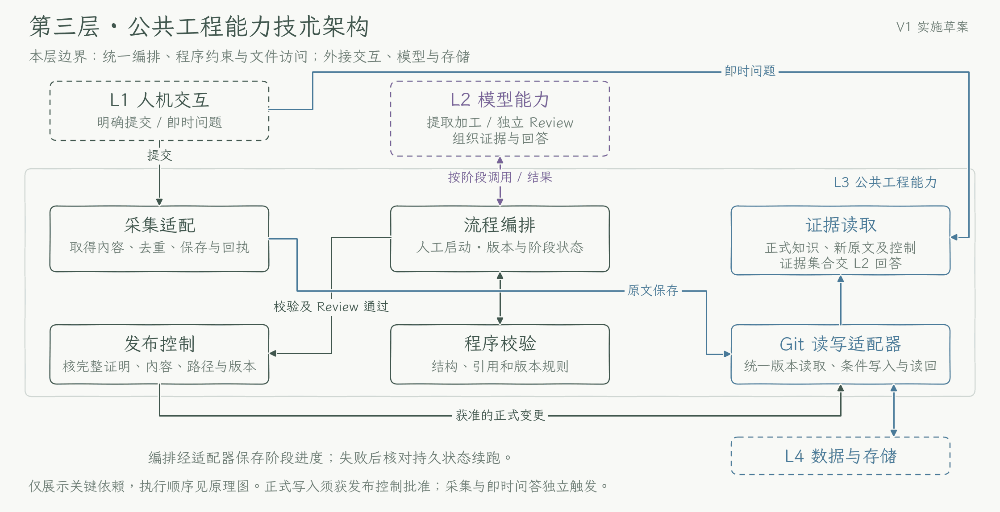

# 第三层：公共工程能力

[返回技术方案](../technical-plan.md) · [执行步骤与恢复](../implementation-details.md) · [数据规范](../data-conventions.md)

本层负责采集适配、受控编排、程序校验、证据读取和条件发布。模型负责理解与审核，程序判断是否允许写入正式知识。模块按职责划分，不要求独立部署。当前程序为 `0.2.0.dev24`，新任务使用 `knowledge-extract@10`／`knowledge-review@8`；真实定时执行环境、两轮实际触发、云端持久恢复及第二模型读取仍待验收，见 [Roadmap](../roadmap.md)。

## 本层技术架构

实框为本层模块，虚线框为层外依赖；箭头表示交接关系。图用于解释职责，图中旧实现细节以本文和现行技术方案为准。

[实现原理图 PNG](../diagrams/layer-3-engineering.png) · [可缩放 SVG](../diagrams/layer-3-engineering.svg)

## 模块与交接

| 模块 | 输入 → 输出 |
| --- | --- |
| 采集适配 | 用户提交的内容 → 原始资料、来源版本与保存回执 |
| 流程编排 | 触发请求、持久进度 → 本轮输入范围、阶段调用与处理结果 |
| 程序校验 | 候选及依据 → 结构、引用、版本、覆盖、统计与时间检查结果 |
| 发布控制 | 有效审核、完整证明、候选与最新基础版本 → 获准发布的变更包或拒绝原因 |
| 证据读取 | 问题范围或所选正式对象 → 正式知识、精确依赖、必要原文及纠正删除控制组成的证据集合 |
| Git 读写适配器 | 文件版本或获准变更包 → 指定版本内容、条件提交与读回结果 |

## 执行方式

1. **恢复并选取输入。** 手动或日程入口读取持久进度，固定本轮获准的来源、片段、旧记录、控制和规则版本。发现增量与 drain 持久队列分别触发、分别留回执；跨日或会话恢复不刷新工作身份和重试次数。
2. **加工并校验。** 显式加载第二层两个角色的固定 Skill 及全部依赖，形成资料清单与可复算统计，再调用提取。保存候选并执行程序校验，通过后才独立 Review。候选、依据、控制或规则变化后，受影响的旧审核失效。
3. **完成独立审核。** 新 queue 默认 `auto`：完整普通 Review 请求不超过 `256000` 字节时一次独立审核；超限或显式 `decomposed-v1` 时执行 object／coverage／global 审核。每份最终正文、Wiki 的精确 record 成员和必要关系均须有实际审核依据。首次 Review 前预检全部非 global 单元；global 在前序真实证书齐备后再核容量。必要语义单元仍超限则 `blocked_capacity`。
4. **控制正式发布。** 发布控制核对候选、路径、基础版本、来源与控制，以及同候选的全部实际 request、result、版本和祖先组成的完整 proof。所有必需项通过后，适配器才接受获准变更包，将互相依赖的记录、Wiki 和清单一致提交。只保存 plan、局部通过或加工者自述均不能放行。
5. **读回并保存进度。** 远程提交成功且读回一致后记录回执。保存失败原因、已完成和剩余范围；执行窗口或 slice 结束保留 continuation。达到持久失败重试上限时隔离该工作单元，无关组继续。采集和即时问答独立触发，不等待后台整理。

持续加工采用逐调用留痕的 audit-only 模式，日常加工与即时问答不设每日或历史累计调用总次数门槛；单批输入容量、并发、速率、服务可用性和有限重试仍生效。单批处理链或跨批协调单元按首次执行一次、失败后最多重试三次持久计数；已完成节点核验后零调用续接，`unknown` 先对账。历史有限模式按原配置恢复，不转换其计数语义。

## 待确认与持续加工交接

`continuous-v1` 新计划缺省选择 `production-v1`；旧无 engine 的计划按原契约恢复。日程持久绑定发现范围、queue／work／pending job 与调用状态，推进分批、最终独立审核和 group 发布。answered 事项带原问题、父事项／运行、来源／对象版本和必要完整回复形成 `continuation_context`；context 只发现获准依赖，关联关系不扩大读取范围。局部纠正只影响对应事实，不抑制无关内容。

`before_call`、`before_publish`、`after_checkpoint` 分别在调用前、正式 CAS 前、持久进度后核对暂停状态、身份、required 条件同步和实际远程版本。required 正式路径必须有 clone 环境绑定和独立持久状态；假回调、本地提交及 `published_local` 均不等于远程确认。换 engine、queue 或 operation 不能重放旧未知结果。

`needs_confirmation` 先保存 Review、运行 pending 和登记 marker，再 CAS 登记统一 registry。容量、I/O 或 CAS 失败保留 `registration_required`，这是已知审核待补登记；保留精确 stage／Review 摘要及版本，恢复重验候选、来源、规则与控制，零模型补登记。只有正式记录采用全部有效回复并核验真实关联祖先后才 resolve，随后对账原等待 work。收到回复、审核通过和正式解决分别记录。

## 读取与双仓边界

current 读取已支持按正式 record／topic 路径选择；topic 自动带上精确版本的 record 依赖。先核验发布、来源、控制与版本，再提供必要原文行；`compact_sources` 去除重复正文副本，保持原文与来源绑定。选择齐全和是否读取全部资料分别报告。

公开工程的 CI 使用人工资料。采集、加工、独立审核、发布、读取、定时编排与恢复代码统一从公库 checkout 加载；`--repo` 指向私库资料根。只读双仓入口核对同名分支、准确公开 HEAD 的 CI、公库工程完整性和私库无活动工程副本，不再核对或同步第二份代码。实际公库核心工程的 `program_commit` 与私库 `data_head` 分别记录，旧运行保留原版本，见[双仓使用说明](../dual-repository.md)。

## 失败处理与验收边界

校验或审核失败的内容留在候选区；需用户判断的事项进入统一清单，无关通过项继续。并发冲突先读取最新版本，保留其他变更；相关依据变化则重审。提交结果不明先核对远程已有提交，成功则补回执，不重复发布。临时目录丢失后从持久记录恢复，未知调用未经核清不能重发。

环境绑定在副作用前核对，公库工程交付不改写私库生产 memory，也不把 dev 资料自动提升到生产；程序回退先核数据兼容性，不能通过删 proof、改 schema、清零计数或整库 reset 让旧 writer 恢复写入。来源／采集仍为 schema `0.1`，正式知识 `0.2`，新10/8合同质量链 `0.12`，旧9/7为 `0.11`、旧8/6仍为 `0.10`；专用已完成提取恢复使用 `0.13` 门禁，旧运行按原版本核验。

在目标定时环境仍需验证完整链路、错配审核拒绝、提交后中断恢复和两轮实际触发。工程组件检查、人工资料集成、真实资料质量、定时环境及第二模型各自记录结果，不能互相替代；检查要求见[场景与验收](../scenarios-and-acceptance.md)。

## 已完成提取的受控接续

10/8返工提取已在真实原生账本中completed、因候选存储超限失败且无Review时，使用[专用恢复证明](../data-conventions.md#quality-completed-recovery)核原缓存、调用及完整历史，先固定新plan与validation_head，再零extract续接真正独立Review。stage0.12与guard0.13原子写入；完整group通过后，生产队列以匹配plan／bundle／候选证明的marker持久采用发布。已published重复执行零写／零调用，旧失败queue／counter与unknown不改。
