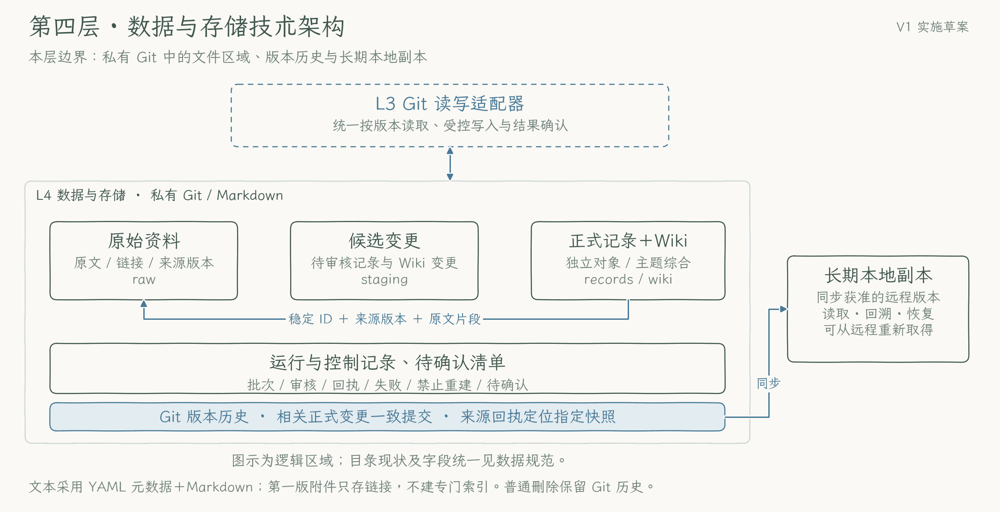

# 第四层：数据与存储

[返回技术方案](../technical-plan.md) · [数据规范](../data-conventions.md) · [发布与恢复步骤](../implementation-details.md)

本层以 Markdown、开放结构化文件和私有 Git 保存长期资料、知识及执行状态。私有远程仓库作为同步依据，本地副本用于读取和恢复；临时工作区不承担唯一存储职责，第一版不建设专门索引。公开工程仓库保存通用方案、程序、Skill、人工测试与 CI，真实原文、知识、审核、模型返回及运行绑定保留在独立私有工作区。

当前程序为 `0.2.0.dev23`，新任务使用 `knowledge-extract@10`／`knowledge-review@8`。来源／采集 schema `0.1`、正式知识 `0.2` 保持，10/8合同运行使用 `0.12`，旧9/7为 `0.11`、更早质量链为 `0.10`；专用已完成提取恢复另有 `0.13` 门禁，不把普通候选升级为0.13。历史 registry、group、普通与显式返工链按其原 schema 核验，不把新格式升级当作重加工或资料迁移。具体版本在[数据规范](../data-conventions.md)维护。

## 本层技术架构

框表示文件区域和副本关系，读写通过第三层。图只说明职责，图中旧实现细节以本文和现行技术方案为准。

[实现原理图 PNG](../diagrams/layer-4-storage.png) · [可缩放 SVG](../diagrams/layer-4-storage.svg)

## 文件角色

| 文件角色 | 保存内容与用途 |
| --- | --- |
| 原始资料 `raw` | 实际取得的文本、链接与获取状态，作为追溯依据 |
| 候选变更 `staging` | 待审核的记录和 Wiki 变更，不作为已发布知识 |
| 正式记录 `records` | 可独立维护的知识对象，关联证据及适用时间 |
| 主题综合 `wiki` | 组织相关记录与主题结论，主要结论分别引用依据 |
| 运行与控制记录 `runs`、待确认清单 `pending` | 批次进度、审核、回执、失败、禁止重建控制及待用户回答的问题 |
| 长期本地副本 | 同步获准资料，支持脱离临时会话读取与恢复 |

英文名是逻辑角色：原始来源映射 `memory/sources/`，正式记录和主题映射 `memory/records/`、`memory/topics/`；其余路径、字段和状态统一见[数据规范](../data-conventions.md#文件角色与实际目录)。这些是私有运行布局，公开仓库不填充个人资料。

## 保存与读取方式

1. **原文先保存。** 相同提交复用已有来源；实际内容变化保留新版本。只有链接时如实记录，附件链接不等于附件本体备份。
2. **按版本找证据。** 从来源 ID、版本和全局片段位置出发，经保存回执定位实际 Git 提交及文件路径，再读取该快照中的原话，不能用最新版冒充旧版本。切片保留完整来源身份，不登记为额外独立事实来源。
3. **分开候选与正式知识。** 候选和审核持续保存；获准的互相依赖记录、Wiki 及发布清单一致提交，读回后另记实际提交回执。正式发布必须绑定完整独立审核 proof；局部通过不能替代完整组。
4. **读取时核对更新。** 主题页帮助定位记录，再查必要原文、相关未加工增量、纠正和删除控制。current 支持按 record／topic 选择并自动核齐精确 record 依赖；`compact_sources` 只去重复传输副本。来源、摘要和回答保持区分，派生内容不能循环作为独立证据。

## 持久状态与环境边界

持久记录须覆盖调用实际状态、retry 身份与计数、语义分片与 coverage、候选关系、最终 Review proof 及消费回执、context／pending 续接与局部控制关系。queue／work／job、完整来源与 reply 范围、已知 Review、group 发布和远程读回均须可恢复；分解审核每个 unit 的 plan／reservation／result／counter 保留。已完成节点只读核验后零调用复用，安全未启动失败有限重试，`unknown` 先核对。

Review 先可靠提交，再用独立 CAS 登记待确认清单。登记失败保留精确 stage／Review 摘要、版本和补登记 marker，状态为 `registration_required`；恢复补登记不重新调用模型。answered、resolved 与正式记录实际采用答复分别保存。

dev 与 production 使用明确环境绑定、数据根和远程范围。clone 局部实际 Git 管理目录保存 `pdm-environment.json`，不把绑定写成共享个人知识；运行状态位于库外私有持久位置，凭据仅保存引用名。私库只保存资料、控制、审核、私人验证和历史，不维护活动代码、提示词、Skill、测试、CI 或工作流；历史工程提交和归档仍保留供原版本核验。运行从公库加载，`--repo` 指向私库，程序版本与资料 HEAD 分别绑定。公库工程交付不改变私库生产 memory，不把开发资料整批提升，也不重写来源或 Review 历史。双仓入口只读核对代码／资料边界与准确公开 CI，不复制工程或迁移资料，见[双仓使用说明](../dual-repository.md)。

新日程 required 模式对必要状态作条件同步并核对实际远程版本。独立 production 的 `published_local` 不是远程确认，本地 Git 或 bare remote 演练不能证明目标云端跨窗口、跨机器持久化。队列、对账和 retry 状态须脱离临时工作区恢复，目标环境能力仍待真实验证。

## 失败处理与恢复

写入结果不明先查远程内容与版本，确认成功后补回执；未成功才重试。本地副本缺失时从远程恢复获准文件并核对来源、记录、主题及历史引用。普通删除同步处理当前知识和禁止重建控制，仍保留 Git 历史，不宣称历史已清除。

回退前暂停正式发布并核对未知调用、远程结果和数据兼容性。保留完整候选、Review、proof、registry、queue、audit、控制、计数及其祖先；旧程序不支持实际 schema 时必须写前拒绝。不能删 marker／event、改 schema、清零计数、重写旧运行或整库 reset 来恢复写入。

从全新副本恢复来源、记录和主题，读回精确历史原文，以及目标云端持久恢复、两轮真实触发与第二模型读取，均按[场景与验收](../scenarios-and-acceptance.md)分别核验。人工加工和本地恢复检查不表示 M1 整体通过，进度见 [Roadmap](../roadmap.md)。

## 候选历史包的有限存储例外

当前10/8、schema0.12候选仅可为完整历史使用最多4 MiB存储包；移除revision_context、revision_revalidation、revision_resume后的当前核心仍最多1 MiB，其余文件1 MiB、模型请求256000字节、多文件事务8 MiB保持。路径、run、固定角色与完整证明都要核验，不能把正文挪入历史绕过限制，见[统一限额](../data-conventions.md#candidate-storage-limits)。

专用已完成提取恢复的stage与schema0.13 guard须同一原子提交，使不支持门禁的旧writer拒写。旧failure、queue、counter和原始返回不覆盖；本地缓存的操作者核定证明与过去Git／服务端已存在的输出摘要明确区分。恢复后仍须独立Review和正式发布，候选不是正式知识。
